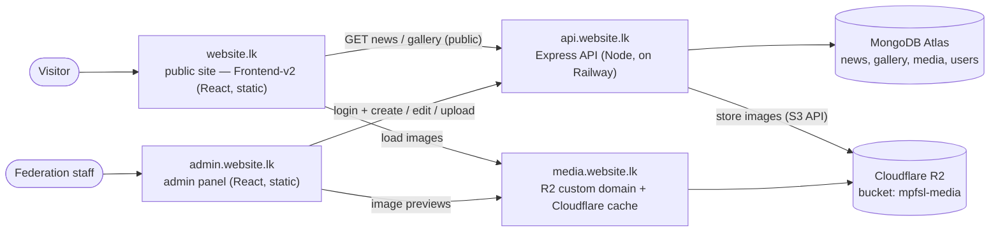

# Architecture

## Overview



- The **public site** and the **admin panel** are both static React builds. Neither talks to MongoDB
  or R2 directly — only the API does.
- **R2 credentials never leave the server.** Browsers only ever *read* images, through
  `media.website.lk`.
- **Images are served by Cloudflare**, not by the API, so the API stays light and pictures load fast
  and are cached worldwide.

## Repository layout

The admin panel and API live in the same repo as the existing frontends:

```
MPFSL/
├── Frontend/          # version 1 — kept for reference, not deployed
├── Frontend-v2/       # public site (website.lk) — the launch version
├── admin/             # NEW — admin panel (React + Vite)
├── server/            # NEW — Express API
├── shared/            # NEW — small shared pieces (e.g. validation schemas, constants)
└── documentation/     # these planning docs
```

### `server/` (Express API)

Organised as feature modules (`modules/news`, `modules/gallery`, `modules/media`, `modules/auth`,
`modules/users`…), each with its own model, validation, service, controller, mapper and routes.
Full layout, patterns and conventions: **[backend-architecture.md](backend-architecture.md)**.

### `admin/` (React admin panel)

```
admin/src/
├── main.jsx, App.jsx         # router + auth guard
├── api/                      # fetch wrapper (sends cookies, handles 401) + one module per resource
├── hooks/                    # useAuth, useNews, useGallery…
├── pages/
│   ├── LoginPage.jsx
│   ├── DashboardPage.jsx
│   ├── news/                 # NewsListPage, NewsEditPage
│   ├── gallery/              # GalleryPage
│   └── users/                # UsersPage (admins only)
├── components/
│   ├── layout/               # AdminLayout, Sidebar, TopBar
│   ├── editor/               # BlockEditor (h4 / paragraph / list blocks), LinkListEditor
│   ├── media/                # ImageUploader, ImagePicker, SortableImageGrid
│   └── ui/                   # Button, Field, Modal, Toast, ConfirmDialog, StatusBadge
└── styles/
```

Same conventions as the public frontends: one component per folder, `.jsx` + `.css` side by side.

## Main flows

### Visitor opens the news section

1. Public site loads (static files from `website.lk`).
2. It calls `GET api.website.lk/api/news` → API returns **published** stories only, newest first,
   with full image URLs on `media.website.lk`.
3. Browser loads the images from `media.website.lk` (cached by Cloudflare).

### Admin publishes a story with photos

1. Admin logs in at `admin.website.lk` → API sets a secure session cookie.
2. Admin uploads photos → `POST /api/admin/media` → API checks each file, resizes it to WebP in
   three sizes, stores them in R2, saves a `Media` record and returns its id + preview URLs.
3. Admin writes the story, attaches the uploaded photos (each needs alt text) and saves as **draft**.
4. Admin clicks **Publish** → story becomes visible to `GET /api/news` immediately.

See [media-storage-r2.md](media-storage-r2.md) for the upload pipeline in detail.

## Why these choices

| Choice | Reason |
|---|---|
| Separate `api.` subdomain | Public site and admin share one API; clean CORS and cookie rules |
| Upload through the API (not direct-to-R2) | API can reject bad files and produce consistent image sizes; simpler and safer for low upload volume |
| Structured story blocks (not free HTML) | Matches the existing `news.js` format, so the public site renders it unchanged, and no risk of injected HTML |
| Static admin panel | Can be hosted for free alongside the public site; all logic lives in the API |
