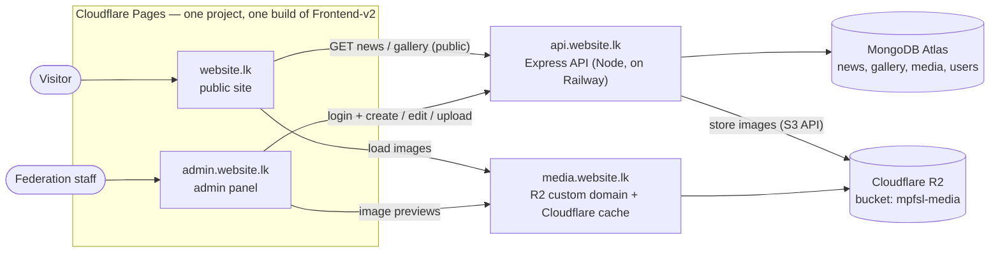

# Architecture

## Overview



- **One frontend, two addresses.** `Frontend-v2` is built once and served on both `website.lk` and
  `admin.website.lk`. On load it checks the hostname: `admin.*` gets the admin panel, anything else
  the public site. Each half is a separate lazy-loaded chunk with its own CSS, so visitors never
  download admin code and the two style systems never mix.
- Both halves are static; neither talks to MongoDB or R2 directly — only the API does.
- **R2 credentials never leave the server.** Browsers only ever *read* images, through
  `media.website.lk`.
- **Images are served by Cloudflare**, not by the API, so the API stays light and pictures load fast
  and are cached worldwide.

## Repository layout

```
MPFSL/
├── Frontend/          # version 1 — kept for reference, not deployed
├── Frontend-v2/       # THE frontend: public site (website.lk) + admin panel (admin.website.lk)
├── server/            # Express API (api.website.lk)
├── shared/            # validation schemas + constants used by the API and the admin panel
└── documentation/     # these planning docs
```

`shared`, `server` and `Frontend-v2` are npm workspaces (root `package.json`); `Frontend/` is not.

### `server/` (Express API)

Organised as feature modules (`modules/news`, `modules/gallery`, `modules/media`, `modules/auth`,
`modules/users`…), each with its own model, validation, service, controller, mapper and routes.
Full layout, patterns and conventions: **[backend-architecture.md](backend-architecture.md)**.

### `Frontend-v2/src/` (public site + admin panel)

```
src/
├── main.jsx                  # picks the public site or the admin panel by hostname
├── App.jsx …                 # public site (plain CSS, unchanged layout: sections/, components/, data/…)
└── admin/                    # admin panel (Tailwind) — only loaded on admin.website.lk
    ├── AdminApp.jsx          # providers (React Query, toasts) + admin styles
    ├── AdminRoutes.jsx       # routes + auth guards
    ├── api/                  # fetch wrapper (sends cookies, handles 401) + one module per resource
    ├── hooks/                # useAuth, useUsers, useTheme, useToast… (later useNews, useGallery)
    ├── lib/                  # config, theme, query client, helpers
    ├── pages/                # Login, ChangePassword, Dashboard, Account, users/… (later news/, gallery/)
    ├── components/
    │   ├── layout/           # AdminLayout, Sidebar, AuthLayout, ThemeToggle, RouteGuards
    │   ├── forms/            # ChangePasswordForm (later BlockEditor, LinkListEditor…)
    │   └── ui/               # Button, Field, Input, Modal, ConfirmDialog, Badge, Alert, Toast…
    └── styles/admin.css      # Tailwind + light/dark colour tokens
```

The public site keeps its conventions (one component per folder, `.jsx` + `.css`); the admin panel
uses Tailwind classes, so its components are single `.jsx` files.

## Main flows

### Visitor opens the news section

1. Public site loads (static files from `website.lk`).
2. It calls `GET api.website.lk/api/news` → API returns **published** stories only, newest first,
   with full image URLs on `media.website.lk`.
3. Browser loads the images from `media.website.lk` (cached by Cloudflare).

### Admin publishes a story with photos

1. Admin logs in at `admin.website.lk` → API sets a secure session cookie.
2. Admin uploads photos → `POST /api/admin/media` → API checks each file, resizes it to WebP in
   three sizes, stores them in R2, saves a `Media` record and returns its id + preview URLs.
3. Admin writes the story, attaches the uploaded photos (each needs alt text) and saves as **draft**.
4. Admin clicks **Publish** → story becomes visible to `GET /api/news` immediately.

See [media-storage-r2.md](media-storage-r2.md) for the upload pipeline in detail.

## Why these choices

| Choice | Reason |
|---|---|
| Separate `api.` subdomain | Public site and admin share one API; clean CORS and cookie rules |
| Upload through the API (not direct-to-R2) | API can reject bad files and produce consistent image sizes; simpler and safer for low upload volume |
| Structured story blocks (not free HTML) | Matches the existing `news.js` format, so the public site renders it unchanged, and no risk of injected HTML |
| One frontend for both addresses | One build and one Cloudflare Pages project to host; shared logo, fonts and theme; all logic lives in the API |
| Admin on its own subdomain | Its own cookies/CORS rules and security headers, and easy to recognise as staff-only |
