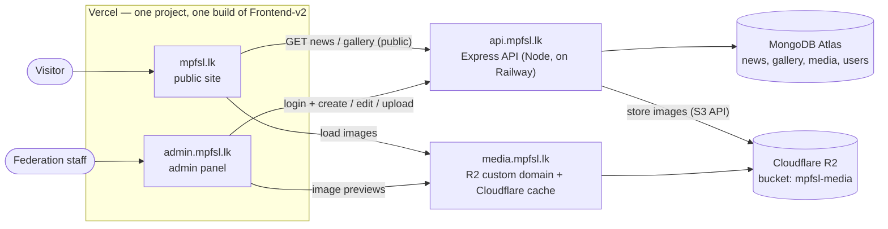

# Architecture

## Overview



- **One frontend, two addresses.** `Frontend-v2` is built once and served on both `mpfsl.lk` and
  `admin.mpfsl.lk`. On load it checks the hostname: `admin.*` gets the admin panel, anything else
  the public site. Each half is a separate lazy-loaded chunk with its own CSS, so visitors never
  download admin code and the two style systems never mix.
- Both halves are static; neither talks to MongoDB or R2 directly — only the API does.
- **R2 credentials never leave the server.** Browsers only ever *read* images, through
  `media.mpfsl.lk`.
- **Images are served by Cloudflare**, not by the API, so the API stays light and pictures load fast
  and are cached worldwide.

## Repository layout

```
MPFSL/
├── Frontend/          # version 1 — kept for reference, not deployed
├── Frontend-v2/       # THE frontend: public site (mpfsl.lk) + admin panel (admin.mpfsl.lk)
├── server/            # Express API (api.mpfsl.lk)
├── shared/            # validation schemas + constants used by the API and the admin panel
└── documentation/     # these planning docs
```

`shared`, `server` and `Frontend-v2` are npm workspaces (root `package.json`); `Frontend/` is not.

### `server/` (Express API)

Organised as feature modules (`modules/news`, `modules/gallery`, `modules/media`, `modules/auth`,
`modules/users`…), each with its own model, validation, service, controller, mapper and routes.
Full layout, patterns and conventions: **[backend-architecture.md](backend-architecture.md)**.

### `Frontend-v2/src/` (public site + admin panel)

```
src/
├── main.jsx                  # picks the public site or the admin panel by hostname
├── App.jsx …                 # public site (plain CSS, unchanged layout: sections/, components/, data/…)
└── admin/                    # admin panel (Tailwind) — only loaded on admin.mpfsl.lk
    ├── AdminApp.jsx          # providers (React Query, toasts) + admin styles
    ├── AdminRoutes.jsx       # routes + auth guards
    ├── api/                  # fetch wrapper (sends cookies, handles 401) + one module per resource
    ├── hooks/                # useAuth, useUsers, useTheme, useToast… (later useNews, useGallery)
    ├── lib/                  # config, theme, query client, helpers
    ├── pages/                # Login, ChangePassword, Dashboard, Account, users/, gallery/, news/
    ├── components/
    │   ├── layout/           # AdminLayout, Sidebar, AuthLayout, ThemeToggle, RouteGuards
    │   ├── forms/            # ChangePasswordForm (later BlockEditor, LinkListEditor…)
    │   └── ui/               # Button, Field, Input, Modal, ConfirmDialog, Badge, Alert, Toast…
    └── styles/admin.css      # Tailwind + light/dark colour tokens
```

The public site keeps its conventions (one component per folder, `.jsx` + `.css`); the admin panel
uses Tailwind classes, so its components are single `.jsx` files.

## Public site pages

Today the public site is **one scrolling page** (`App.jsx` → `HomePage`), and the menu jumps to its
sections. That can't meet the [BestWeb.LK 2027 targets](bestweb-2027.md): search engines see one
page with one title, and there's no room for athletes, results or competitions. The target structure:

| URL | Page | Data from |
|---|---|---|
| `/` | Home: hero, stats, latest achievement, upcoming competitions, featured athletes, latest news, gallery, contact | API + static |
| `/about`, `/about/committees`, `/about/governance` | History, vision, mission, committees, coaches, officials, governance, safeguarding, anti-doping | static (later API) |
| `/modern-pentathlon` | The sport, five disciplines (interactive), rules, equipment, beginner guide | static |
| `/athletes`, `/athletes/<slug>` | Teams, searchable list, profiles | API `athletes` |
| `/competitions`, `/competitions/<slug>` | Calendar, event page (venue, registration, documents, results, photos) | API `competitions` |
| `/results`, `/rankings` | Results explorer, national rankings, records | API `results` |
| `/international` | UIPM, Asian Games, World Cups / Championships, achievements | static + API |
| `/news`, `/news/<slug>` | News list and one page per story | API `newsstories` |
| `/gallery` | Photos and videos | API |
| `/development` | Youth, schools, talent, coaching, officials | static |
| `/resources` | Rules, regulations, circulars, forms, policies | API `documents` |
| `/contact`, `/privacy`, `/cookies` | Contact form, legal pages | static |
| anything else | 404 page | — |

How it's built:

- **Routing:** `react-router` (already a dependency) in `App.jsx`. Every page sets its own `<title>`,
  meta description, canonical URL, Open Graph tags and JSON-LD (`SportsOrganization` on every page;
  `Event`, `Article`, `Person`, `BreadcrumbList` where they fit).
- **Pre-rendering:** each URL is rendered to HTML at build time (static site generation), so crawlers,
  social-media previews and slow phones get real content before any JavaScript runs. Pages built from
  API data (athletes, results, news) are re-built by a Vercel deploy hook when an editor
  publishes, and still fetch fresh data in the browser.
- **SEO files:** `robots.txt` and `sitemap.xml` generated at build time; `admin.mpfsl.lk` stays
  `noindex`.
- **Performance budget:** Lighthouse ≥ 90 on mobile. The hero already paints a still photo before the WebGL
  slideshow; the slideshow should also be skipped on small screens and slow connections. The
  preloader in `index.html` is plain HTML/CSS and is lifted within 2.5 s at most. Images use
  `srcset` with the WebP variants from R2.
- **Languages (later):** `/si/…` and `/ta/…` with `hreflang` links, translations checked by a person.

## Main flows

### Visitor opens the news section

1. Public site loads (static files from `mpfsl.lk`).
2. It calls `GET api.mpfsl.lk/api/news` → API returns **published** stories only, newest first,
   with full image URLs on `media.mpfsl.lk`.
3. Browser loads the images from `media.mpfsl.lk` (cached by Cloudflare).

### Admin publishes a story with photos

1. Admin logs in at `admin.mpfsl.lk` → API sets a secure session cookie.
2. Admin uploads photos → `POST /api/admin/media` → API checks each file, resizes it to WebP in
   three sizes, stores them in R2, saves a `Media` record and returns its id + preview URLs.
3. Admin writes the story, attaches the uploaded photos (each needs alt text) and saves as **draft**.
4. Admin clicks **Publish** → story becomes visible to `GET /api/news` immediately.

See [media-storage-r2.md](media-storage-r2.md) for the upload pipeline in detail.

## Why these choices

| Choice | Reason |
|---|---|
| Separate `api.` subdomain | Public site and admin share one API; clean CORS and cookie rules |
| Upload through the API (not direct-to-R2) | API can reject bad files and produce consistent image sizes; simpler and safer for low upload volume |
| Structured story blocks (not free HTML) | Matches the existing `news.js` format, so the public site renders it unchanged, and no risk of injected HTML |
| One frontend for both addresses | One build and one Vercel project to host; shared logo, fonts and theme; all logic lives in the API |
| Admin on its own subdomain | Its own cookies/CORS rules and security headers, and easy to recognise as staff-only |
