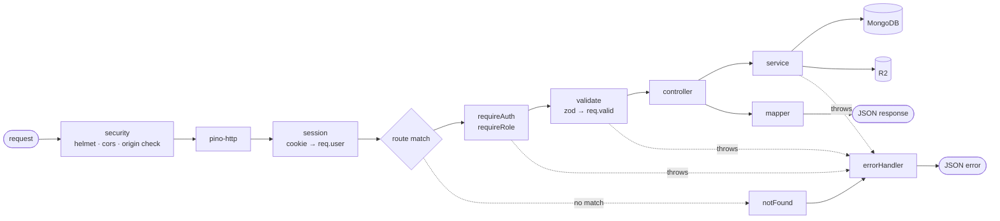

# Backend Architecture (`server/`)

How the Express API is organised in code. Read [architecture.md](architecture.md) first for the big
picture and [api.md](api.md) for the endpoints this code implements.

## Tech choices

| Area | Choice | Why |
|---|---|---|
| Runtime | **Node 22 LTS** | current LTS on Railway |
| Language | **JavaScript, ES modules** (`"type": "module"`) + JSDoc types | same as the frontends; no build step to deploy |
| Framework | **Express 5** | stable; async errors reach the error handler automatically (no `try/catch` in every route) |
| Database | **Mongoose 9** on MongoDB Atlas | schemas, validation, transactions |
| Validation | **zod** | one schema validates the request *and* gives clean error messages; the admin panel reuses the same schemas from `shared/` |
| Auth | own **database sessions** (opaque token in an HttpOnly cookie) + **argon2** | logout / deactivation take effect immediately (see [auth-and-security.md](auth-and-security.md)) |
| Uploads | **multer 2** (memory) + **sharp** | read files, then check and resize them |
| R2 | **@aws-sdk/client-s3** | R2 speaks the S3 API |
| Security | **helmet**, **cors**, **express-rate-limit** | |
| Logging | **pino** + **pino-http** | fast JSON logs; Railway shows them in its log viewer |
| Tests | **vitest** + **supertest** + **mongodb-memory-server** | real HTTP requests against an in-memory database |
| Dev | `node --watch`, **eslint**, **prettier** | |

## Structure: feature modules

Code is grouped **by feature** (news, gallery, media…), not by type. Everything about news lives in
one folder, so a change to news touches one place.

```
server/
├── package.json
├── .env.example                  # every variable with a dummy value (real .env is git-ignored)
├── src/
│   ├── index.js                  # entry: load config → connect DB → start HTTP server → graceful shutdown
│   ├── app.js                    # builds the Express app (no listen) — imported by tests too
│   ├── config/
│   │   └── env.js                # validates process.env with zod; app refuses to start if anything is missing
│   ├── lib/                      # shared building blocks, no Express inside
│   │   ├── db.js                 # mongoose connect / disconnect, transaction helper
│   │   ├── logger.js             # pino instance
│   │   ├── errors.js             # AppError + helpers (notFound, conflict, forbidden…)
│   │   ├── r2.js                 # putObject / deleteObjects / publicUrl
│   │   ├── images.js             # sharp: inspect + make thumb/medium/large WebP
│   │   ├── slug.js               # title → unique slug
│   │   └── passwords.js          # argon2 hash / verify, temporary password generator
│   ├── middleware/
│   │   ├── security.js           # helmet, cors (per-origin rules), origin check for writes
│   │   ├── session.js            # reads session cookie → req.user (or nothing)
│   │   ├── requireAuth.js        # 401 if no req.user
│   │   ├── requireRole.js        # 403 unless req.user.role is allowed
│   │   ├── validate.js           # validate({ body, query, params }) with zod → req.valid
│   │   ├── rateLimits.js         # login limiter, general API limiter
│   │   ├── upload.js             # multer config (size / count limits)
│   │   ├── notFound.js           # unknown route → 404
│   │   └── errorHandler.js       # turns any error into the standard JSON error response
│   ├── modules/
│   │   ├── auth/                 # login, logout, me, change password; Session model
│   │   ├── users/                # admin-only user management; User model
│   │   ├── media/                # upload / list / update / delete; Media model
│   │   ├── news/                 # admin CRUD + publish/feature + public list; NewsStory model
│   │   ├── site-photos/          # replaced photos/captions of the gallery spots; SitePhoto model
│   │   ├── audit/                # AuditLog model + record() used by other modules
│   │   └── health/               # GET /health
│   └── routes.js                 # mounts every module's routers under /api
├── scripts/
│   ├── create-admin.js
│   ├── import-existing.js
│   └── find-unused-media.js
└── tests/
    ├── setup.js                  # start in-memory MongoDB, fake R2, reset between tests
    ├── helpers.js                # loginAs(role), uploadTestImage(), factories
    ├── fixtures/                 # small test images (jpg, png, heic, fake.svg, huge.jpg…)
    └── *.test.js                 # one file per module, e.g. news.test.js
```

### Inside a module

Every module has the same files, e.g. `modules/news/`:

| File | Job | May use |
|---|---|---|
| `news.model.js` | Mongoose schema + indexes | — |
| `news.schemas.js` | zod schemas for request bodies / queries (re-exported from `shared/`) | — |
| `news.service.js` | **business rules**: create, publish, feature, delete, list | models, `lib/*`, other modules' services |
| `news.controller.js` | **HTTP only**: take `req.valid`, call the service, send the response | its service, mapper |
| `news.mapper.js` | DB document → API shape (`toPublic`, `toAdmin`) | `lib/r2.publicUrl` |
| `news.routes.js` | URLs + middleware chain → controller | middleware, controller |

Rules that keep it tidy:

- **Controllers never touch models**, and **services never touch `req`/`res`.** A service can be
  called from a route, a script (`import-existing.js`) or a test in exactly the same way.
- **Only mappers decide what leaves the API.** `passwordHash`, internal ids or draft stories can't
  leak by accident, because responses are always built by a mapper, never by sending a raw document.
- Modules talk to each other **through services**, e.g. `news.service` calls
  `media.service.assertExists(ids)`, never `Media.find()` directly.

## Request lifecycle



## Key code patterns

These are the patterns to copy; not finished code.

### App assembly (`app.js`)

```js
export function createApp() {
  const app = express()
  app.set('trust proxy', 1)            // Railway proxy — needed for Secure cookies + real client IPs
  app.disable('x-powered-by')

  app.use(securityMiddleware())        // helmet, cors, origin check on writes
  app.use(httpLogger)
  app.use(express.json({ limit: '200kb' }))
  app.use(cookieParser())
  app.use(loadSession)                 // sets req.user when a valid session cookie is present
  app.use('/api', apiLimiter, routes)
  app.use(notFound)
  app.use(errorHandler)
  return app
}
```

`index.js` only does `await connectDb(); createApp().listen(env.PORT)` and closes the server and DB
connection on `SIGTERM` (Railway sends it on every redeploy).

### Routes (`news.routes.js`)

```js
export const publicNewsRouter = Router()
  .get('/', validate({ query: listQuery }), controller.listPublic)
  .get('/:slug', controller.getPublic)

export const adminNewsRouter = Router()
  .use(requireAuth, requireRole('editor', 'admin'))
  .get('/', validate({ query: adminListQuery }), controller.list)
  .post('/', validate({ body: createStory }), controller.create)
  .patch('/:id', validate({ params: idParam, body: updateStory }), controller.update)
  .post('/:id/publish', validate({ params: idParam }), controller.publish)
  .post('/:id/feature', validate({ params: idParam }), controller.feature)
  .delete('/:id', validate({ params: idParam }), controller.remove)
```

`routes.js` mounts them: `/news` → public, `/admin/news` → admin, and so on for each module.

### Controller (`news.controller.js`)

```js
export async function create(req, res) {
  const story = await newsService.create(req.valid.body, req.user)
  res.status(201).json({ story: toAdmin(story) })
}
```

No `try/catch`: Express 5 sends thrown/rejected errors to `errorHandler`.

### Service (`news.service.js`)

```js
export async function feature(id, user) {
  return withTransaction(async (session) => {
    const story = await NewsStory.findById(id).session(session)
    if (!story) throw notFound('Story')
    if (story.status !== 'published') throw conflict('Publish the story before featuring it')

    await NewsStory.updateMany({ isFeatured: true }, { isFeatured: false }, { session })
    story.isFeatured = true
    story.updatedBy = user.id
    await story.save({ session })

    await audit.record({ user, action: 'news.feature', target: story.id }, session)
    return story
  })
}
```

Multi-document changes (featuring, deleting with media checks) use a **transaction**, so a crash
halfway can't leave two featured stories.

### Validation (`validate.js`)

```js
export const validate = (schemas) => (req, _res, next) => {
  req.valid = {}
  for (const part of ['params', 'query', 'body']) {
    if (schemas[part]) req.valid[part] = schemas[part].parse(req[part])   // throws ZodError → 400
  }
  next()
}
```

Schemas use `.strict()` so unknown fields are rejected, and they set lengths for every string
(e.g. title ≤ 160 chars, block text ≤ 4,000 chars, ≤ 50 blocks).

### Errors (`errors.js` + `errorHandler.js`)

```js
export class AppError extends Error {
  constructor(status, code, message, fields) { super(message); Object.assign(this, { status, code, fields }) }
}
export const notFound = (what) => new AppError(404, 'NOT_FOUND', `${what} not found`)
export const conflict = (msg) => new AppError(409, 'CONFLICT', msg)
export const forbidden = () => new AppError(403, 'FORBIDDEN', 'You don’t have permission to do that')
```

`errorHandler` converts everything to the format in [api.md](api.md):

| Error | Becomes |
|---|---|
| `AppError` | its own status / code / message |
| `ZodError` | 400 `VALIDATION_ERROR` with `fields` |
| Mongoose `CastError` (bad id) | 404 `NOT_FOUND` |
| Mongo duplicate key `11000` | 409 `CONFLICT` (e.g. slug or email taken) |
| multer `LIMIT_FILE_SIZE` / `LIMIT_FILE_COUNT` | 413 `FILE_TOO_LARGE` / 400 `TOO_MANY_FILES` |
| anything else | 500 `INTERNAL`, generic message; full error logged, never sent to the client |

### Sessions (`modules/auth`)

- Login: verify password → create a random 32-byte token → store **only its SHA-256 hash** in
  `sessions` (`{ tokenHash, user, expiresAt, lastSeenAt, userAgent, ip }`) → send the raw token in
  the cookie.
- `loadSession` middleware: hash the cookie value → find the session → check it isn't expired and
  the user is still `active` → set `req.user = { id, role, name, email }` and extend `expiresAt`
  (sliding, at most once a minute to avoid a DB write per request).
- Logout deletes the session; deactivating a user deletes all their sessions.
- A MongoDB **TTL index** on `expiresAt` cleans up old sessions automatically.

### Uploads (`modules/media`)

`POST /admin/media` → `upload.array('files', 10)` → `media.service.createMany(files, alts, user)`:
for each file `images.inspect()` (real type, size) → `images.makeVariants()` → `r2.putObject() × 3`
→ `Media.create()`. If any step fails for a file, its already-uploaded variants are deleted
before the error is returned. Details in [media-storage-r2.md](media-storage-r2.md).

"Is this photo still used?" is answered by querying (`NewsStory.exists({ 'images.media': id })`
or `SitePhoto.exists({ media: id })`) rather than keeping a counter, so it can never drift out
of sync.

### Config (`config/env.js`)

```js
const Env = z.object({
  NODE_ENV: z.enum(['development', 'test', 'production']),
  PORT: z.coerce.number().default(8080),
  MONGODB_URI: z.string().url(),
  SESSION_SECRET: z.string().min(32),
  R2_ACCOUNT_ID: z.string(), R2_ACCESS_KEY_ID: z.string(), R2_SECRET_ACCESS_KEY: z.string(),
  R2_BUCKET: z.string(), MEDIA_BASE_URL: z.string().url(),
  ADMIN_ORIGIN: z.string().url(), PUBLIC_ORIGINS: z.string(),
})
export const env = Env.parse(process.env)   // crash at startup with a clear message, not later at 2am
```

Nothing else reads `process.env` directly.

## `shared/` package

A tiny local package (`"name": "@mpfsl/shared"`) used by both `server/` and the admin panel (`Frontend-v2`) through an npm
workspace:

```
shared/
├── package.json
└── src/
    ├── schemas/          # zod: story, block, link, gallery item, user, login…
    └── constants.js      # roles, statuses, gallery sizes, upload limits
```

The admin panel's forms validate with the **same rules** as the API, so a form that passes in the
browser won't be rejected by the server.

The repo root `package.json` has `"workspaces": ["shared", "server", "Frontend-v2"]`.
`Frontend/` (version 1) stays independent.

## Testing

| Level | What | How |
|---|---|---|
| Integration (most tests) | each endpoint: happy path, validation errors, 401/403 per role | supertest against `createApp()`, in-memory MongoDB **replica set** (needed for transactions) |
| Unit | `images.js` (rotation, EXIF/GPS stripped, never upscales, rejects SVG), slug, mappers | vitest with the fixture images |
| R2 | uploads and deletes | `lib/r2.js` swapped for an in-memory fake in `tests/setup.js` — no real bucket in tests |

Must-have test cases: an editor can do everything on news/gallery but gets **403** on `/admin/users`;
drafts never appear in `GET /news`; only one featured story after featuring twice; deleting media
that's in use returns **409**; login lockout after 5 failures.

## npm scripts (`server/package.json`)

| Script | Does |
|---|---|
| `dev` | `node --watch --env-file=.env src/index.js` |
| `start` | `node src/index.js` (Railway) |
| `test` | `vitest run` |
| `lint` | `eslint .` |
| `create-admin` | `node scripts/create-admin.js` |
| `import-existing` | `node scripts/import-existing.js` |

## Conventions

- File names: `<module>.<role>.js` (e.g. `gallery.service.js`); folders lowercase.
- Named exports everywhere (easier to search and to mock in tests).
- Dates stored as UTC `Date`; the frontends format them.
- Ids in URLs are Mongo ObjectIds for admin routes and **slugs** for public story URLs.
- Every write that changes what the public sees (publish, unpublish, feature, delete, gallery order)
  calls `audit.record()`.
- One pull request per module where possible, with its tests.

## Build order

Matches [roadmap.md](roadmap.md):

1. `config`, `lib/logger`, `lib/errors`, `lib/db`, `app.js`, `health` module, error handler, tests setup
2. `auth` + `users` (+ `create-admin.js`)
3. `lib/r2`, `lib/images`, `media`
4. `news`, `gallery`, `audit`
5. `import-existing.js`
