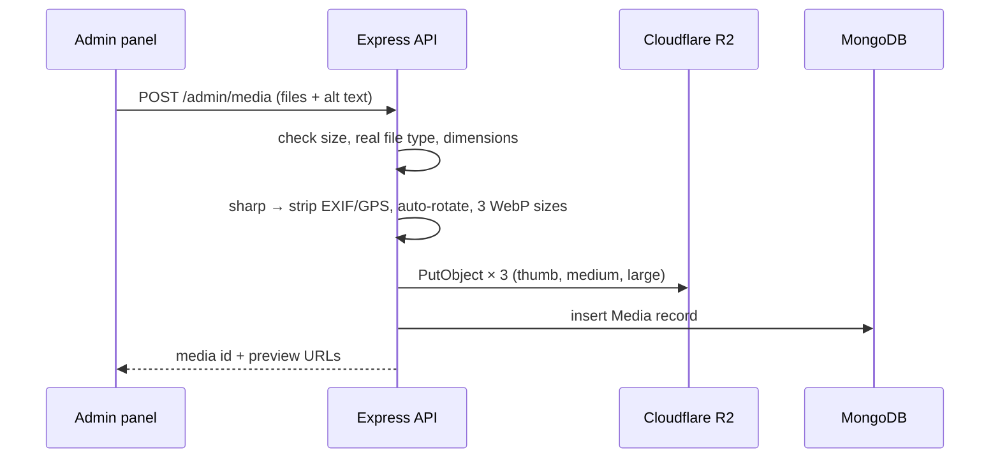

# Media Storage — Cloudflare R2

## Bucket setup

| Setting | Value |
|---|---|
| Bucket name | `mpfsl-media` (plus `mpfsl-media-dev` for development) |
| Public access | **Custom domain** `media.mpfsl.lk` (not the `r2.dev` URL, which is rate-limited and meant for testing) |
| API token | R2 token with **Object Read & Write**, scoped to this bucket only; stored only in the API's environment |
| CORS | Not needed — browsers never upload to R2 directly, they only load images through the custom domain |
| Cache | Cloudflare cache rule on `media.mpfsl.lk`: cache everything, edge TTL 1 year (object keys never change, see below) |

The API talks to R2 through its S3-compatible endpoint with `@aws-sdk/client-s3`:

```js
new S3Client({
  region: 'auto',
  endpoint: `https://${R2_ACCOUNT_ID}.r2.cloudflarestorage.com`,
  credentials: { accessKeyId: R2_ACCESS_KEY_ID, secretAccessKey: R2_SECRET_ACCESS_KEY },
})
```

## Upload pipeline

Uploads go **through the API** (not straight from the browser to R2). Upload volume is low (a few
photos per story), and this lets the server check and resize every image the same way.



1. **Receive** with `multer` (memory storage), max **15 MB** per file, max 10 files per request.
2. **Check the real file type** with `sharp(buffer).metadata()` — don't trust the file extension or
   the browser's MIME type. Accept JPEG, PNG, WebP, HEIC. **Reject SVG** (can contain scripts) and
   anything sharp can't decode. Reject images over ~50 megapixels.
3. **Process** with sharp:
   - `.rotate()` — apply the phone's orientation, then
   - strip all metadata (EXIF, including **GPS location** from phones)
   - produce three WebP versions:

     | Variant | Long edge | Used for |
     |---|---|---|
     | `thumb` | 480 px | admin lists, small story thumbnails |
     | `medium` | 1200 px | story photo grids, gallery tiles |
     | `large` | 2000 px | lightbox, featured story, hero |

     Never upscale — a small original keeps its own size.
4. **Store** each variant in R2 with `Cache-Control: public, max-age=31536000, immutable` and
   `Content-Type: image/webp`.
5. **Record** a `Media` document (see [data-model.md](data-model.md#media)).

If any R2 upload fails, delete the variants already uploaded for that image and return an error,
so no orphaned files are left behind.

## Object keys

```
media/<yyyy>/<mm>/<random-id>/thumb.webp
media/<yyyy>/<mm>/<random-id>/medium.webp
media/<yyyy>/<mm>/<random-id>/large.webp
```

- `<random-id>`: 16+ random characters (e.g. `nanoid`). Original file names are **not** used in
  keys (they can contain personal info and odd characters).
- Keys never change and are never reused, so images can be cached for a year. "Replacing" a photo
  means uploading a new one.

## Deleting

- Removing a photo from a story or the gallery only unlinks it; the file stays in the media library.
- Deleting from the media library removes all three R2 objects and the DB record — refused (409)
  while it's still in use.
- A monthly maintenance script (`server/scripts/find-unused-media.js`) lists media not used anywhere
  for 90+ days so an admin can clean up.

## Moving the current photos in

`server/scripts/import-existing.js` (run once):

1. Reads `Frontend-v2/src/data/news.js`, `photos.js` and `gallery.js`.
2. Runs every photo in `src/assets/images/news/` through the same pipeline above.
3. Creates the news stories (as **published**, with their original dates) and gallery items.

The Unsplash gallery photos can be imported the same way (download → pipeline) with their
photographer saved in `credit`, or replaced by the federation's own photos.

## Costs (R2)

R2 has no charge for downloads (egress). For a federation site the free tier (10 GB storage,
1M writes and 10M reads per month) should cover it; ~3 variants × ~300 KB per photo means
roughly 10,000 photos before storage costs anything.
